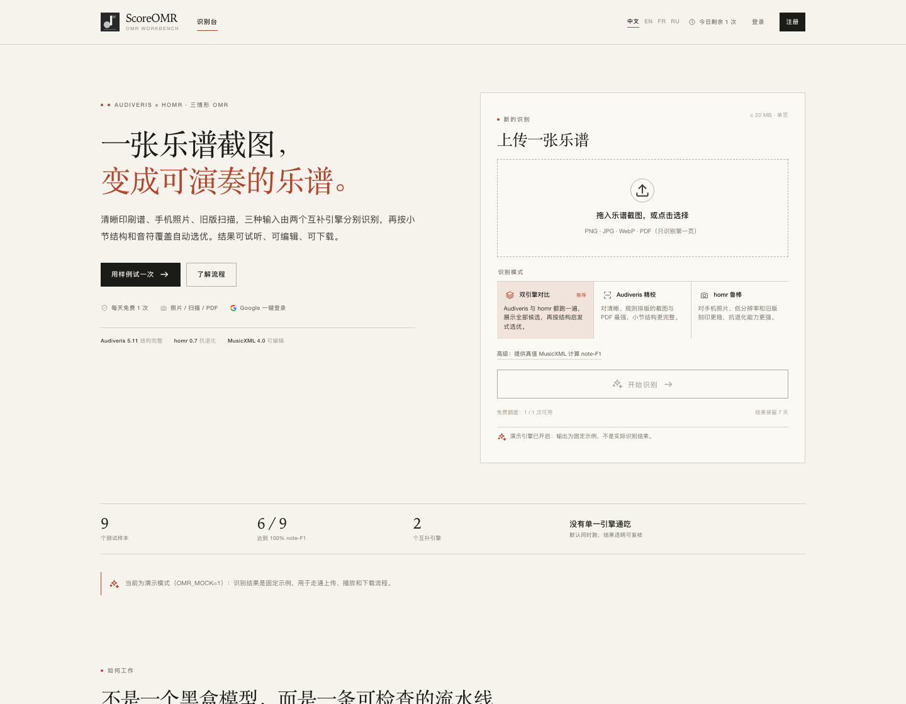
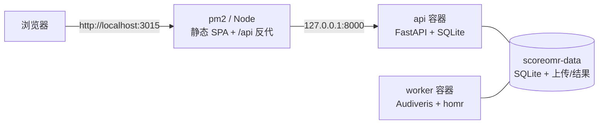

# ScoreOMR · 乐谱截图转 MusicXML

> 一张乐谱截图，变成可演奏、可编辑的乐谱。
> Audiveris × homr 双引擎，完全免费、开源。**本地运行，无需注册登录。**



- 界面截图：[识别台](docs/screenshots/home.png) · [结果页](docs/screenshots/job-result.png) · [手机首页](docs/screenshots/mobile.png) · [手机结果页](docs/screenshots/mobile-job.png)
- 部署：[pm2 + 3015 + Docker](docs/DEPLOY_PM2.md) · [全 Docker / 阿里云](docs/DEPLOY_ALIYUN.md) · [Zeabur 免费一键部署（公网 demo，iPhone 可用）](docs/DEPLOY_ZEABUR.md)
- 架构与取舍：[docs/ARCHITECTURE.md](docs/ARCHITECTURE.md)
- OMR 实测与三情形说明：[docs/OMR.md](docs/OMR.md)

这是一个**免费、开源、可独立移动**的全栈工程：原来的三情形 OMR 研究代码
（清晰印刷谱 / 手机照片 / 真实扫描）收在 `services/backend/omr_agent`，
外面补齐了上传、队列、结果下载、pm2 入口和容器化 worker。

**没有账户体系：** 不填任何 API key 也能启动；打开即用，自己上传、自己识别、
自己下载。任务历史按浏览器会话（本地 Cookie）记录，仅自己可见。

**没有每日额度：** 次数不限，唯一限制是同一时间只处理 1 个任务
（`MAX_ACTIVE_JOBS` 可调）。

**没有自动清理：** 上传与识别结果永久保存在本地数据卷，磁盘占用由你自己管理。

界面是 **Bauhaus 骨架 + 禅意极简**：暖纸色、墨色、单一朱砂强调色；标题用宋体/衬线，
正文用无衬线；只保留 1px 细线和大量留白。页面右上角有
**中文 / EN / FR / RU** 四语切换，默认中文，选择会保存在浏览器。

> **仓库边界：** 整个可提交的仓库就是 `scoreomr/` 一个文件夹。代码、Docker 配置、
> 文档和截图都在里面；`git init` / `git add .` 也在这个文件夹内执行。真实的
> `.env`、数据卷、`node_modules`、`.venv` 都不在仓库里。

---

## 1. 它能做什么

- 上传 PNG / JPG / WebP / TIFF / BMP 或单页 PDF，得到：
  - `best.musicxml`：可编辑的识别结果；
  - `best.mid` / `best.wav`：MIDI 与离线合成音频；
  - `notes.csv`：逐音符表；
  - `piano_roll.png`：钢琴卷帘；
  - `report.json`：候选引擎、耗时、小节合法率、质量分、可选 note-F1。
- 三种识别模式：
  - **双引擎对比（推荐）**：Audiveris + homr 都跑，展示全部候选后按结构启发式选优；
  - **Audiveris 精校**：清晰印刷谱、数字 PDF，结构更完整；
  - **homr 鲁棒**：手机照片、低分辨率扫描、旧版刻印，抗退化更强。
- 9 个带真值的演示样例（OLiMPiC，CC BY-SA 4.0），可直接看 note-F1。

### 为什么是“三情形 + 双引擎”

原研究测试（9 个样本）的核心结论是：**没有单一引擎通吃**。

| 输入情形 | Audiveris note-F1 | homr note-F1 | 谁更稳 |
|---|---:|---:|---|
| 干净整行 | **100%** | 9.9% | Audiveris |
| 相邻 system 残片 | 19.3% | **90.7%** | homr |
| 手机照片 | **100%** | 82.7% | Audiveris |
| 真实扫描 A | 35.1% | **100%** | homr |
| 真实低清扫描 593×146 | 0% | **61.7%** | homr |
| 强退化 620px | 失败 | **100%** | homr |

完整表格、局限和复现方式见 [docs/OMR.md](docs/OMR.md)。产品因此默认同时跑两个
引擎，把候选摆出来，而不是假装 100% 准确。

---

## 2. 架构：pm2 管入口，Docker 管重活



| 组件 | 作用 | 运行方式 |
|---|---|---|
| `apps/web/server.mjs` | 静态 SPA + `/api` 反代 + 可选 TLS | **pm2**，端口 3015 |
| `api` | 任务、文件 | Docker，仅 127.0.0.1:8000 |
| `worker` | 消费 SQLite 队列、跑 OMR、写结果 | Docker，唯一的重镜像 |
| `scoreomr-data` | SQLite + 上传 + 结果 | 一个命名卷 |
| `web` 容器 | 全 Docker 备选方案 | 可选，不参与 pm2 路径 |

**为什么不是全部塞进 pm2：** Audiveris 依赖 Java、homr 依赖 ONNX 模型，
装在宿主机上会让升级和回滚变脏；Docker 里隔离更稳。pm2 负责轻量的 Node
入口，正好匹配 3015 + pm2 的部署习惯。

**为什么不用 Postgres / Redis / Celery：** 单机、低并发，真正的硬需求是
「持久化任务队列」；SQLite 的 WAL + `BEGIN IMMEDIATE` 已经保证。少两个容器、
少一组密码和备份对象。

---

## 3. 快速开始

### 3.1 本地开发（不需要 Docker）

要求：Node.js ≥ 22.12、pnpm、[uv](https://docs.astral.sh/uv/)（推荐）。

```bash
cd scoreomr
pnpm setup
pnpm dev
```

- 前端：<http://127.0.0.1:5173>
- API：<http://127.0.0.1:8000/api/health>
- 数据：`.dev-data/`（可随时删除）

`pnpm dev` 默认 `OMR_MOCK=true`，用固定示例 MusicXML 走通上传 → 播放 → 下载，
所以本机没有 Java/Audiveris/homr 也能完整验收。

真实 OMR 引擎：

```bash
export AUDIVERIS_BIN=/Applications/Audiveris.app/Contents/MacOS/Audiveris
WITH_HOMR=1 pnpm setup
OMR_MOCK=false pnpm dev
```

也可以只跑 CLI：

```bash
cd services/backend
.venv/bin/python -m omr_agent.compare 你的截图.png --out /tmp/out --gt 真值.musicxml
.venv/bin/python -m omr_agent.pipeline 你的截图.png --out /tmp/out --engines audiveris
.venv/bin/python -m omr_agent.route 你的截图.png --out /tmp/out
```

### 3.2 服务器：pm2 + 3015（自用推荐）

**前置安装**（Ubuntu 24.04）：完整说明见
[docs/DEPLOY_PM2.md](docs/DEPLOY_PM2.md) 第 2 节；最短版本：

```bash
sudo apt-get update && sudo apt-get install -y git curl ca-certificates

# Docker
curl -fsSL https://get.docker.com | sudo sh
sudo systemctl enable --now docker
sudo usermod -aG docker "$USER"   # 重新登录 SSH 后生效

# Node 22 + pnpm + pm2
curl -fsSL https://deb.nodesource.com/setup_22.x | sudo -E bash -
sudo apt-get install -y nodejs
sudo corepack enable
corepack prepare pnpm@11.28.5 --activate
sudo npm install -g pm2
```

然后：

```bash
git clone <你的仓库> /opt/scoreomr
cd /opt/scoreomr
cp .env.example .env
nano .env
```

一个可用的最小配置（无账户、无额度、无自动清理）：

```dotenv
APP_ENV=production
APP_URL=http://<服务器公网IP>:3015

PORT=3015
API_HOST_PORT=8000

# 可选；本机直接用 HTTP 即可
TLS_CERT_FILE=
TLS_KEY_FILE=
EDGE_TRUST_PROXY=0
```

启动（两种方式，任选一种）：

```bash
# 方式 A：一条命令完成“构建 + 起容器 + 起 pm2”
pnpm install --frozen-lockfile
pnpm pm2:start
pm2 save
pm2 startup
```

```bash
# 方式 B：手动分步
pnpm install --frozen-lockfile
pnpm build
docker compose -f compose.yml -f compose.pm2.yml up -d --build api worker
pm2 start npm --name "scoreomr" -- start -- --port 3015
pm2 save
pm2 startup
```

打开：

```text
http://<服务器公网IP>:3015
```

确认：

```bash
curl -fsS http://127.0.0.1:8000/api/health
curl -fsS http://127.0.0.1:3015/api/health
pm2 status
```

> **公开 HTTPS（可选）：** 想用域名 + HTTPS，把 `APP_URL` 改成
> `https://omr.example.com:3015`，按
> [DEPLOY_PM2.md](docs/DEPLOY_PM2.md) 第 4 节申请证书并填 `TLS_CERT_FILE` /
> `TLS_KEY_FILE`，然后 `pm2 restart scoreomr --update-env`。
>
> **`pm2 startup`** 会打印一条需要 `sudo` 执行的命令；执行一次即可开机自启。
> 不要在没有 `apps/web/dist` 和 api 容器的情况下只跑 `pm2 start npm ...`；
> 方式 A 的 `pnpm pm2:start` 会自动完成这些前置步骤。

### 3.3 全 Docker（备选）

```bash
cp .env.example .env
# 设置 APP_URL、DOMAIN
docker compose -f compose.yml -f compose.tls.yml up -d --build
```

Caddy 自动 HTTPS，web 容器在 8080（仅回环）。这条路径和 pm2 路径共享同一套
API/worker 镜像，二选一即可。

---

## 4. 隐私与任务归属

- **没有账户、没有注册、没有登录**，也没有任何第三方 API key 依赖。
- 任务历史按浏览器在本地写入的匿名 Cookie（`omr_anon`）归属：
  - 同一个浏览器打开「我的任务」能看到自己的历史；
  - 换浏览器、换设备或清除 Cookie 后看不到之前的任务；
  - 清 Cookie 不能「抢看」别人的任务，因为归属是随机的浏览器标识。
- 结果文件永久保存在本地数据卷（`scoreomr-data` 或 `.dev-data/`），不会自动删除。
  磁盘占用由自己管理；体积过大时用 `pnpm docker:reset` 清空重来。

---

## 5. 配置

可在 `.env` 中覆盖的全部变量见 [.env.example](.env.example)。最常改的：

| 变量 | 默认 | 说明 |
|---|---|---|
| `APP_ENV` | `production` | 生产禁止 `OMR_MOCK=true` |
| `APP_URL` | `http://localhost:3015` | 公开地址；HTTPS 时 Cookie 自动带 Secure |
| `MAX_UPLOAD_MB` | `20` | 单文件上限 |
| `JOB_TIMEOUT_SECONDS` | `900` | 单个任务的引擎超时 |
| `MAX_ACTIVE_JOBS` | `1` | 同一浏览器同时最多任务数 |
| `MAX_QUEUE_LENGTH` | `20` | 队列长度上限 |
| `OMR_MOCK` | `false` | 生产必须 false；`pnpm dev` 默认 true |
| `AUDIVERIS_HEAP` | `1536m` | 构建时写入 Audiveris 配置 |
| `WORKER_PLATFORM` | `linux/amd64` | Audiveris 只有 amd64 Linux 包 |
| `HOMR_INIT` | `1` | 构建时预下载 homr 模型 |

> 修改 `.env` 后：Node 进程 `pm2 reload scoreomr --update-env`；API/worker 用
> `docker compose -f compose.yml -f compose.pm2.yml up -d api worker` 重新创建。
> `restart` 不会重新读取环境变量。

---

## 6. 数据、备份与迁移

- 命名卷：`scoreomr-data` → 容器内 `/data`
  - `/data/scoreomr.db`：SQLite（WAL）
  - `/data/jobs/<id>/`：上传与结果
- 备份：

```bash
pnpm db:backup
# => backups/scoreomr-YYYYmmdd-HHMMSS.db
```

- 恢复：

```bash
bash scripts/restore.sh backups/scoreomr-YYYYmmdd-HHMMSS.db
```

- 迁移到另一台机器：
  1. `pnpm db:backup`；
  2. 把整个文件夹和备份文件拷走；
  3. 新机器 `pnpm install && pnpm build`，启动 api/worker 容器；
  4. `bash scripts/restore.sh ...`；
  5. 如果结果文件也要带走，用
     `docker run --rm -v scoreomr-data:/data -v $PWD:/backup alpine tar czf /backup/data.tgz -C /data .`
     打包卷再解压。
- 数据库里保存的路径都是相对 `DATA_DIR` 的，工程中没有写死本机绝对路径；
  `pnpm build`、`pnpm dev`、`pm2 start`、`docker compose` 均可在新目录直接运行。
- **数据库结构变更：** 建议直接清空旧数据卷（`pnpm docker:reset`）后重新部署。

---

## 7. 目录结构

```text
scoreomr/
├── apps/web/
│   ├── server.mjs            3015 Node 网关：静态文件 + /api 反代 + 可选 TLS
│   ├── src/pages/            识别台 / 结果 / 我的任务 / 404
│   ├── src/lib/i18n.tsx      中/英/法/俄四语词典与 Locale 切换
│   └── src/styles.css        Bauhaus 骨架 + 禅意极简设计系统
├── services/backend/
│   ├── app/                  FastAPI、SQLite、匿名 Cookie 归属、worker
│   │   ├── worker.py         队列消费与引擎调度
│   │   ├── db.py             schema + 原子任务队列
│   │   └── routes/           jobs / public
│   ├── omr_agent/            原三情形 OMR 核心（预处理/引擎/指标/播放/选优）
│   ├── samples/              9 个演示图 + 真值 + 授权
│   ├── tests/                20 个后端测试
│   └── pyproject.toml / uv.lock
├── deploy/                   Dockerfile ×3、nginx.conf、Caddyfile
├── compose.yml               默认全栈
├── compose.pm2.yml           只起 api + worker，供 pm2 路径
├── compose.tls.yml           可选 Caddy 全 Docker HTTPS
├── ecosystem.config.cjs      pm2 配置（3015）
├── scripts/                  setup / dev / pm2-start / test / backup / restore
├── docs/                     PM2 部署、Docker、架构、OMR 实测、截图
└── package.json / pnpm-lock.yaml
```

`omr_agent` 仍保留独立 CLI，可直接 `python -m omr_agent.compare ...`，不依赖 Web。

---

## 8. 测试与验收

```bash
pnpm test          # 后端 pytest + 前端 tsc + vite build
pnpm test:api      # 只跑后端
pnpm lint          # python compileall + tsc
```

后端测试覆盖：

- 匿名 Cookie 归属：换浏览器看不到对方任务，历史列表只含自己的任务；
- 上传格式白名单（PNG/PDF）、GT DOCTYPE 拒绝、允许文件名过滤；
- worker 端到端：生成 MusicXML/MIDI/WAV/CSV/PNG、清理中间目录、孤儿任务重排队、
  超时任务超过尝试次数后标记失败；
- 健康检查与公开配置、生产环境拒绝 mock。

前端当前是 `tsc --noEmit + vite build` 验收；页面用 Chrome 在桌面 1440px、
手机 390px 下截图检查，并逐页切换中文 / English / Français / Русский 检查布局。

---

## 9. 已知限制

- 单机架构：一个 API、一个 worker、SQLite。适合个人自用，不适合多机水平扩展。
- OMR 不是 100% 准确。低分辨率、复杂钢琴谱、旧版刻印仍会错；结果页会标记
  “建议复核”。请试听并检查 MusicXML。
- PDF 只识别第一页；一次只处理一张/一页。
- 任务历史按浏览器 Cookie 归属：换浏览器或清 Cookie 后历史不可见（结果文件
  仍在磁盘上，用文件管理直接访问数据卷可找回）。
- 结果文件不会自动清理，磁盘占用需自己管理；AB 卷迁移见第 6 节。
- 演示样例来自 OLiMPiC，CC BY-SA 4.0；保留 `services/backend/samples/ATTRIBUTION.md`。
- **许可证：** 本工程代码 MIT；Audiveris 与 homr 是 **AGPL-3.0**。通过网络提供
  识别服务时请遵守 AGPL 源码提供义务；闭源使用前请评估或取得另行授权。
  详见 [NOTICE](NOTICE)。

---

## 10. 提交到 GitHub

```bash
cd scoreomr
git init
git branch -M main
git add .
git commit -m "ScoreOMR: local dual-engine OMR, no accounts, no quotas"
git remote add origin git@github.com:<你的账号>/<仓库名>.git
git push -u origin main
```

提交前确认：

- **仓库根目录就是 `scoreomr/`**，不要把文件夹再套一层；
- `.env` 没有被加入（`.gitignore` 已忽略）；
- 没有真实的密钥、域名私密信息或服务器凭据；
- `services/backend/samples/` 的 OLiMPiC 授权文件一起提交；
- GitHub Actions：`.github/workflows/ci.yml` 已就绪。

---

## 11. 许可

- 本工程自有代码：MIT，见 [LICENSE](LICENSE)。
- 第三方组件、数据集与 AGPL 说明：见 [NOTICE](NOTICE)。
- OLiMPiC 示例数据：CC BY-SA 4.0，见 `services/backend/samples/LICENSE-OLiMPiC.txt`。