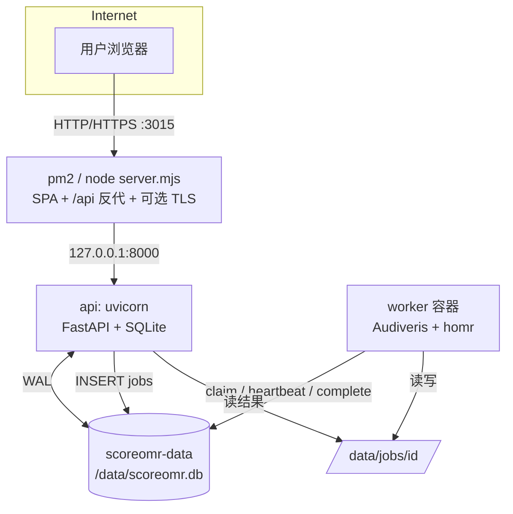
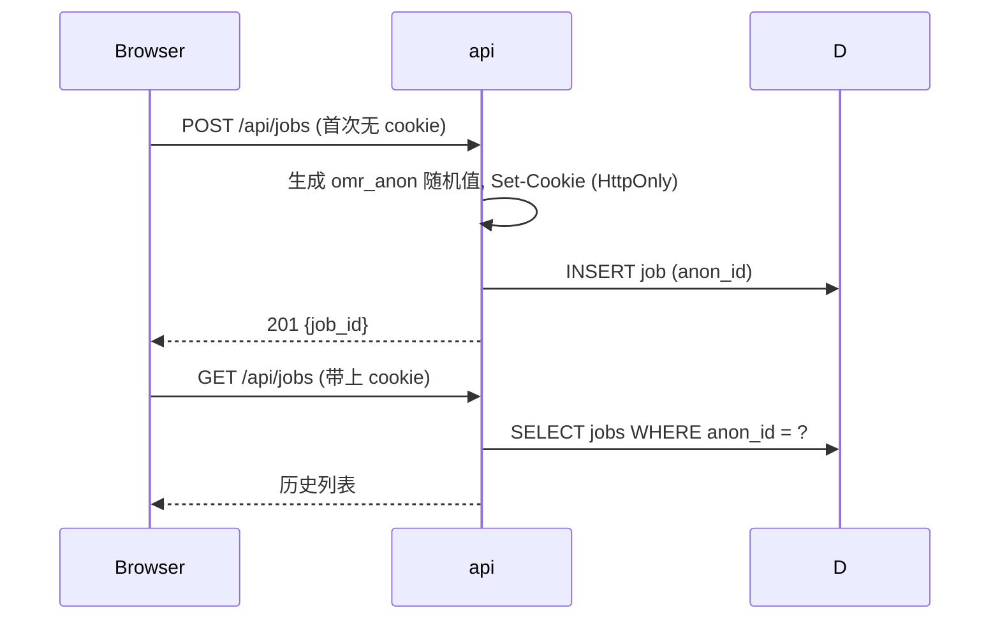

# 架构与关键取舍

## 1. 目标与约束

把一份**研究型 OMR 原型**变成可独立部署的免费、开源服务，同时保持：

1. 整个文件夹可以单独移动，不依赖本机绝对路径；
2. 2–4 GB 内存、1–2 vCPU 的机器能跑；
3. OMR 引擎的重依赖不污染 API / Node 入口；
4. 任务队列有明确持久化语义；
5. 公网入口用 pm2 + 3015，重活留给 Docker；
6. 没有账户体系；不配置任何 key 也能启动。

## 2. 部署拓扑（主路径：pm2 + 3015）



- `apps/web/server.mjs` 由 pm2 管理，监听 3015。它只做三件事：
  静态 SPA、把 `/api/*` 流式反代到 `127.0.0.1:8000`、可选 TLS。
- API 容器只发布到宿主 `127.0.0.1:8000`，公网访问不到；因此
  `X-Forwarded-For` 只能由 Node 入口写入，从未被信任的远端伪造过。
- worker 与 API 共用命名卷 `scoreomr-data`，均以 uid `10001` 运行。
- worker 使用 `linux/amd64`（Audiveris 只提供 amd64 Linux 包）。API/Node 可以
  在 arm64 原生跑；Apple Silicon 上只有 worker 走模拟。
- 全 Docker + Caddy 是备选路径；`compose.pm2.yml` 只发布 api 的宿主回环端口，
  并把 web 放进未启用的 profile。

### 为什么 pm2 只管 Node

Audiveris 需要 Java、homr 需要 ONNX 模型，放宿主机上会让升级/回滚污染系统。
Docker 隔离更稳；pm2 负责轻量、可快速重启的 Node 入口。需要“一条命令起全部”
时用 `pnpm pm2:start`，它会先起容器，再让 pm2 接管 Node；容器本身由 Docker
的 restart policy 保活。

### 为什么 Node 入口可以做 TLS

pm2 路径可以用 `TLS_CERT_FILE` / `TLS_KEY_FILE` 让 Node 直接对 3015 提供
HTTPS。也可以在 Node 前面放 Cloudflare Tunnel / Caddy，此时设
`EDGE_TRUST_PROXY=1`。内网测试可以 HTTP；公开部署建议 HTTPS。

## 3. 一次识别请求

```mermaid
sequenceDiagram
  participant B as Browser
  participant N as pm2 Node :3015
  participant A as api
  participant D as SQLite
  participant K as worker

  B->>N: POST /api/jobs (multipart)
  N->>A: proxy
  A->>A: 校验大小/类型, Pillow 归一化 input.png
  A->>D: BEGIN IMMEDIATE; 活跃任务/队列; INSERT job
  D-->>A: queued
  A-->>B: 201 {job_id}
  B->>N: GET /api/jobs/id 每 1.5s
  K->>D: claim_next_job() -> running
  K->>K: 预处理 -> Audiveris/homr -> 选优 -> MIDI/WAV/CSV
  K->>D: complete_job(report, files)
  B->>N: GET /api/jobs/id
  N->>A: proxy
  A-->>B: done + report + file list
```

- 上传在 API 层归一化成单张 RGB PNG；worker 不处理 PDF/Pillow 兼容问题。
- 任务结果写到 `jobs/<id>/result/`；API 只在 `done` 时提供下载。
- worker 每 10 秒心跳；停止后，重启的 worker 会把心跳过期的 `running` 任务
  重新排队（最多 2 次尝试）。
- Node 代理保留 Range 头，音频 `<audio>` 的 206 响应可以正常工作。

## 4. 匿名任务归属（无账户）



- **没有账户系统：** 无注册、无登录、无 Google OAuth，也不依赖任何第三方 key。
- 每个浏览器首次访问时由服务端生成一个随机 `omr_anon`（HttpOnly + SameSite=Lax，
  180 天），任务按这个 ID 归属，只有拿着相同 cookie 的请求能看到。
- 换浏览器、换设备或清除 Cookie 后，历史不可见（结果文件仍在数据卷里）。
- 没有每日额度、没有退款语义；结果文件不会自动清理。

## 5. 数据模型

SQLite schema 在 `services/backend/app/db.py`，`PRAGMA user_version=4`。

| 表 | 用途 |
|---|---|
| `jobs` | 任务状态、模式、相对路径、报告、归属（`anon_id`）、尝试次数 |
| `service_state` | worker 心跳/引擎可用性 |

没有账户、会话、额度或支付字段。所有文件路径存成相对 `DATA_DIR` 的形式
（如 `jobs/<id>/result`），移动数据目录或换机器不需要改库。

### 任务归属

```text
BEGIN IMMEDIATE
  n_active = SELECT COUNT(*) FROM jobs
             WHERE anon_id = ? AND status IN ('queued','running')
  if 队列长度 >= MAX_QUEUE_LENGTH: ROLLBACK -> 503 queue_full
  if n_active >= MAX_ACTIVE_JOBS:  ROLLBACK -> 409 active_job_exists
  INSERT job
COMMIT
```

- `BEGIN IMMEDIATE` 让“检查活跃任务 + 建任务”成为一个串行化写事务。
- 归属按浏览器匿名 ID（`omr_anon` cookie）计算，不保留 IP 或任何个人数据。
- 同一个浏览器同时最多 `MAX_ACTIVE_JOBS` 个任务；失败任务不“扣”任何东西，
  因为没有额度概念。

## 6. 任务状态与失败语义

```text
queued --claim--> running --complete--> done
                     |
                     +--exception/timeout--> error
running --心跳过期--> queued (attempts < 2)
running --心跳过期--> error (attempts >= 2)
```

- `attempts` 在 claim 时 +1；最多 2 次，避免坏图无限重试。
- worker 启动时 `recover_stale()`；运行中每 60 秒检查一次。
- 单个引擎崩溃/超时只让该候选 `failed/timeout`；另一个引擎仍可产出结果。
- 两个候选都失败 -> 任务 `error`，用户看到可读提示后重试。
- 上传与结果保留在数据卷里，不会自动清理；由用户自行备份或清理。

## 7. 安全清单

- 上传：扩展名 + Pillow 实际解码 + 像素/大小上限；PDF 只栅格化第一页。
- 真值 XML：拒绝 `DOCTYPE`/`ENTITY`，避免外部实体。
- 路径：任务 id 服务端生成；相对路径经 `resolve_data_path` 校验；下载白名单。
- 越权：任务按匿名 cookie 归属校验；不命中统一 404。
- 代理：API 只发布到 `127.0.0.1`；Node 覆盖 `X-Forwarded-For`；只有显式
  `EDGE_TRUST_PROXY=1` 才信任上游代理头。
- 匿名 Cookie：`HttpOnly` + `SameSite=Lax`；HTTPS 下自动带 `Secure`。
- 无密钥：不保存任何第三方密钥，也没有账户级密钥/会话。
- 容器：API/Web `no-new-privileges`；非 root uid 10001；日志轮转。

## 8. 可移植性

- 没有写死 `/Users/...`；`DATA_DIR`、`DATABASE_PATH`、`SAMPLES_DIR` 均可配置。
- Docker 卷是命名卷，不依赖 compose 绝对路径；bind mount 仅限
  `./deploy/*` 与 `./backups`。
- 前端构建产物是纯静态文件；Node 入口只依赖 Node stdlib，不需要
  `node_modules` 就能启动（但需要先构建 `dist/`）。
- 单文件夹复制后：
  - 开发：`pnpm install && pnpm setup && pnpm dev`；
  - pm2：`pnpm install && pnpm build`，起 api/worker 容器，
    `pm2 start npm --name "scoreomr" -- start -- --port 3015`；
  - 全 Docker：`docker compose up -d --build`。
- Python 依赖锁在 `uv.lock`，Node 依赖锁在 `pnpm-lock.yaml`。

## 9. 扩展路线

| 规模 | 建议 |
|---|---|
| 1 台 2–4 GB | 当前架构：SQLite + 单 worker |
| 多 worker / 多 API | SQLite → Postgres；`jobs` claim 改 `FOR UPDATE SKIP LOCKED` |
| 大量结果文件 | 本地卷 → S3/OSS；API 用预签名 URL |
| 队列优先级 | Redis/RQ/Celery 或 Postgres 队列；保留 `jobs` 状态机 |
| 多用户共享 | 若需要公网上共享使用，再引入账户体系（届时评估额度与限流） |
| 监控 | `/api/health` + 日志采集；Prometheus 指标与告警 |

`app/db.py` 是唯一直接依赖 SQLite 的模块；`app/jobs.py` 和 worker 只依赖它的
方法，迁移时不需要改路由和引擎适配器。
